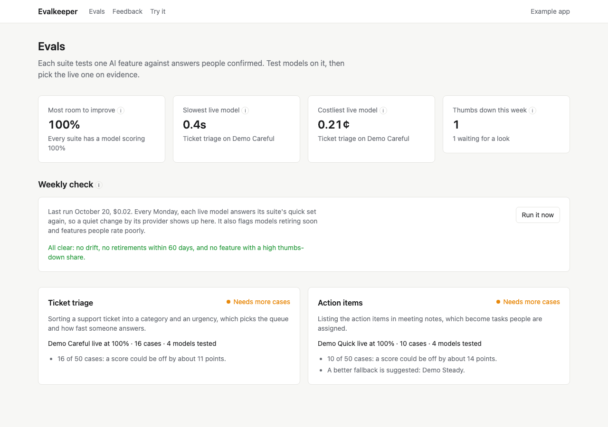
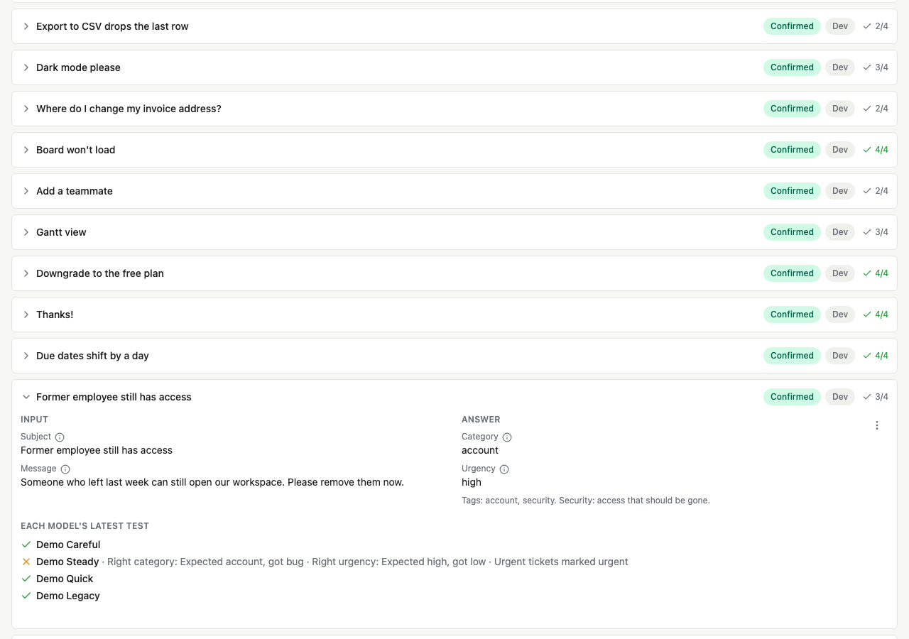
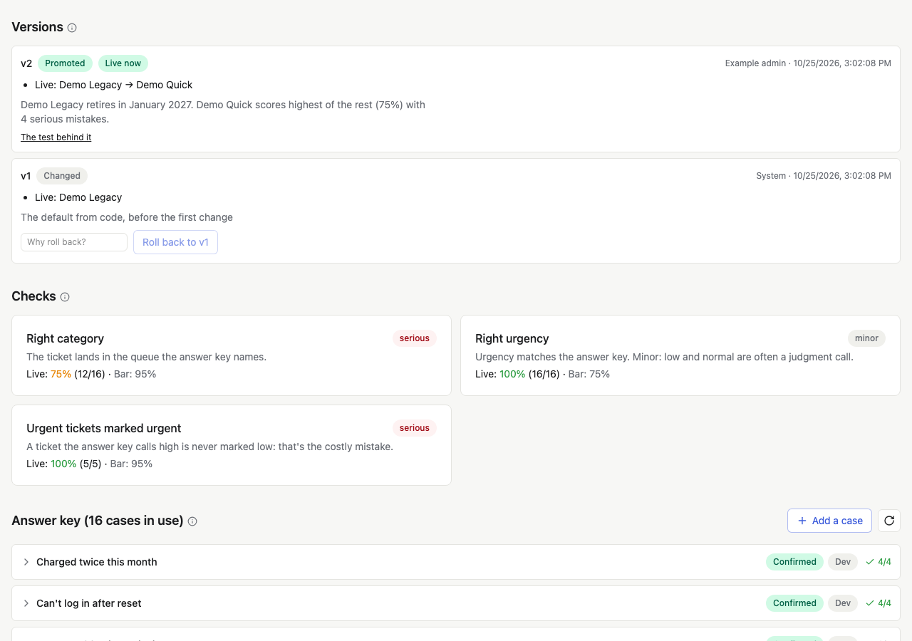
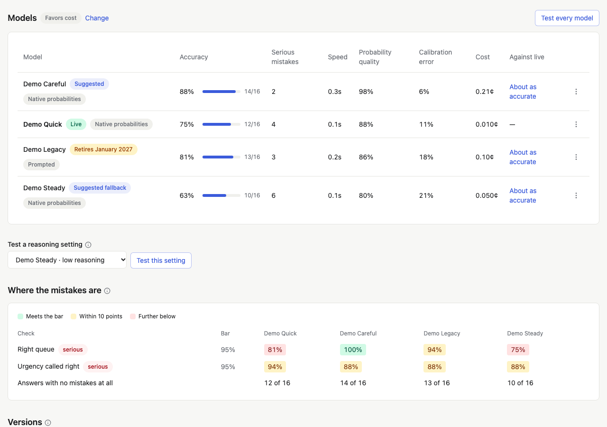
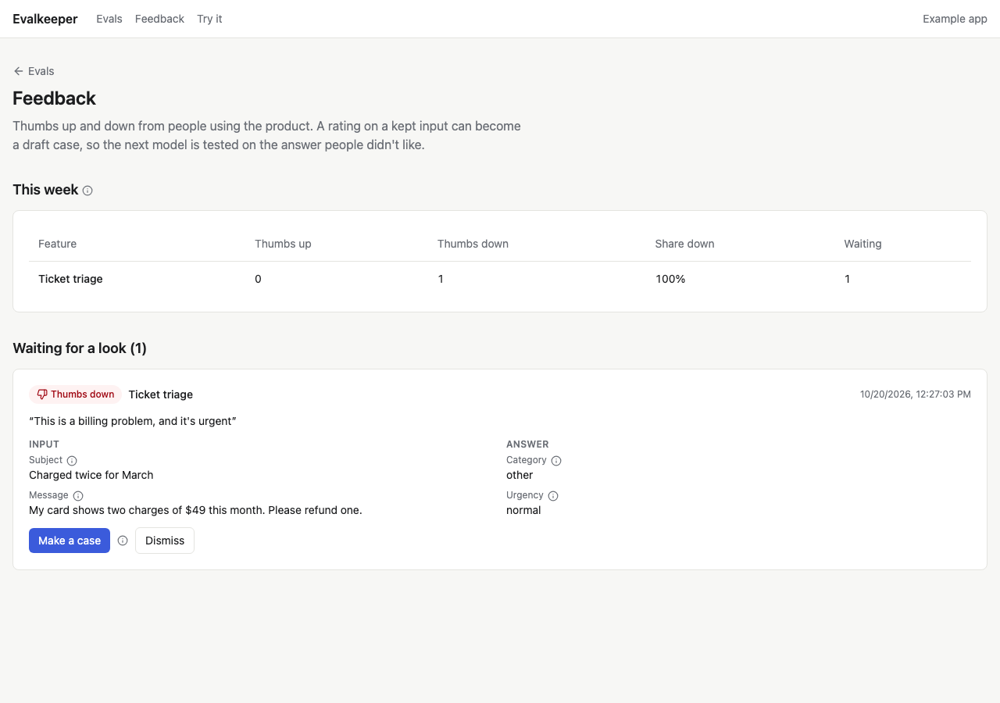

# Evalkeeper

**An eval harness for the AI features in your TypeScript app.** For each
feature, keep an answer key people confirm, run any model against it, and
compare models on accuracy, serious mistakes, cost, and speed. Evalkeeper
suggests a live model and a fallback with its reasons, records every
switch, and checks weekly that the live model hasn't drifted.

[](https://github.com/seanhudson/evalkeeper/actions/workflows/ci.yml)
[](LICENSE)
[](https://www.npmjs.com/package/@crowandraven/evalkeeper)

```bash
npm install @crowandraven/evalkeeper
```

<picture>
  <source media="(prefers-color-scheme: dark)" srcset="docs/screenshots/board-dark.png">
  
</picture>

---

## Why

An AI feature in production changes under you. Providers retire models,
quietly update them under the same name, and change prices. Someone edits
a prompt. A cheaper model ships that might be good enough. Most teams find
out what broke from a user.

Evalkeeper turns each AI feature into a **suite**: real inputs, answers a
person confirmed, and checks that grade any model's output against them.
Run a suite on every model your app can use, and you get a board that
says, in plain words, which model to make live, which to keep as the
fallback, and why.

It was extracted from a production app where it chose models for 20
AI features. The [lessons](docs/lessons.md) from that work are part of the
design.

## What you get

- **Answer keys people own.** A model can draft cases and answers, but
  nothing is graded against an answer until a person confirms it. Answers
  put to use before review are marked provisional, and every score says so.
- **Tests per model.** Every case, on any model, with time and cost per
  answer. Identical requests are reused for a week, so retesting is free.
- **Checks that say what matters.** Each check is serious (it changes what
  your product does) or minor (a fair difference of judgment), with its
  own bar. Partial credit where an answer has parts.
- **A model board.** Every model's latest test, its serious mistakes, speed,
  and cost, and a bootstrap comparison with the live model: _more accurate_,
  _about as accurate_, _less accurate_, or _too few cases to tell_.
- **A suggestion with its reason.** Accuracy is the floor. A switch needs a
  real reason: clearly more accurate, fewer serious mistakes, or, for a
  suite that favors cost or speed, the same results at half the cost or
  time. Retiring models are never suggested. The fallback comes from
  another provider.
- **Honest staleness.** Tests record the instructions (prompt, output
  schema, and tool descriptions), the cases, and the grader they ran
  with. Change any of them and older tests say they're out of date.
  Regrading stored answers is free and never pretends an old test ran on
  new inputs.
- **Every change on the record (optional).** Which model each feature
  runs on is kept as numbered versions: who changed it, when, why, and the
  test behind it, with one-click rollback. A change to the instructions in
  code is recorded too.
- **A weekly drift check.** Each suite's quick set runs again on its live
  model every week, so a provider quietly changing a model shows up as
  drift, next to models about to retire and features people rate poorly.
- **Feedback that becomes tests.** Thumbs up and down on your AI answers,
  a weekly flag when a feature's thumbs-down share climbs, and one click to
  turn a rating on a kept input into a draft case (with consent, and
  never confirmed for you).
- **Decision models, graded on their probabilities.** For features that
  answer typed questions (pick a queue, say true or false) with the AI
  SDK's decisions, a suite scores the pick and the probabilities: how close
  they were (probability quality) and whether a model that says 90% is
  right 90% of the time (calibration error). The board marks which models
  give probabilities natively and which are prompted.
- **Built for real platforms.** Answers time out, long tests continue in a
  fresh request instead of dying at the platform's limit, stuck tests are
  marked failed, and a provider out of credits stops a test instead of
  failing every answer.

## Quick start

The example app runs with demo models, so it needs no API keys.

```bash
git clone https://github.com/seanhudson/evalkeeper.git
cd evalkeeper
npm install
npm run build
cd examples/next
cp .env.example .env
npm run setup
npm run dev
```

Open <http://localhost:3000/evals> and press **Test every model** on a
suite. Then try the product side at <http://localhost:3000/try>: triage a
ticket, thumb the answer down, and turn it into a case from the feedback
page. Add `OPENAI_API_KEY` or `ANTHROPIC_API_KEY` to `.env` to test real
models next to the demo ones; action items are then matched by meaning
with a judge model instead of by shared words.

## A look around

**The hub:** where every suite stands, what needs attention, and the
weekly check.

<picture>
  <source media="(prefers-color-scheme: dark)" srcset="docs/screenshots/hub-dark.png">
  
</picture>

**The answer key:** each case opens to its input, its confirmed answer,
and how every model did on it.

<picture>
  <source media="(prefers-color-scheme: dark)" srcset="docs/screenshots/answer-key-dark.png">
  
</picture>

**Versions:** every change to which model is live, with the test
behind it, and a rollback that asks why.

<picture>
  <source media="(prefers-color-scheme: dark)" srcset="docs/screenshots/history-dark.png">
  
</picture>

**Decision models:** the same picks, told apart by their probabilities.
Native decision models next to a prompted one, with probability quality
and calibration error.

<picture>
  <source media="(prefers-color-scheme: dark)" srcset="docs/screenshots/decisions-dark.png">
  
</picture>

**Feedback:** thumbs from people using the product, ready to become
cases.

<picture>
  <source media="(prefers-color-scheme: dark)" srcset="docs/screenshots/feedback-dark.png">
  
</picture>

## Add it to your app

Evalkeeper is a small core with adapters, not a platform. Your app keeps
its own routing, auth, and pages.

**1. Install.**

```bash
npm install @crowandraven/evalkeeper @crowandraven/evalkeeper-prisma @crowandraven/evalkeeper-ai-sdk
```

**2. Add the tables.** Copy the models from
[`packages/prisma/schema/evalkeeper.prisma`](packages/prisma/schema/evalkeeper.prisma)
into your schema. They work on PostgreSQL, MySQL, and SQLite.

**3. Write a suite** for one AI feature: its input, what a good answer is,
how to call the feature on a given model, and how to grade the output.

```ts
import type { Suite } from "@crowandraven/evalkeeper";
import { z } from "zod";

export const ticketTriage: Suite<Input, Output, Label> = {
  key: "ticket_triage",
  operation: "ticket_triage",
  label: "Ticket triage",
  description: "Sorting a support ticket into a queue and an urgency.",
  priority: { favor: "cost" }, // runs often, in the background
  graderVersion: "1",
  input: z.object({ subject: z.string(), body: z.string() }),
  labelValue: z.object({ category: z.string(), urgency: z.string() }),
  checks: [
    {
      key: "category",
      label: "Right category",
      kind: "label",
      severity: "serious",
      description: "The ticket lands in the right queue.",
    },
  ],
  run: (input, { model, onCost }) => triage(input, model, onCost), // your code
  grade: async (_input, out, want) => [
    { key: "category", pass: want ? out.category === want.category : null },
  ],
  inputFromForm: (form) => ({ subject: String(form.get("subject")), body: "" }),
  title: (input) => input.subject,
};
```

**4. Create the runner** with your store, suites, model catalog, and
routing.

```ts
import { createRunner } from "@crowandraven/evalkeeper/runner";
import { prismaStore } from "@crowandraven/evalkeeper-prisma";

export const runner = createRunner({
  store: prismaStore(prisma),
  suites: [ticketTriage],
  models: MODELS, // labels, providers, prices, retirement dates
  promptVersion: (operation) => PROMPT_VERSIONS[operation],
  route: (operation) => routeFor(operation), // what's live now
  candidates: () => ({ models: Object.keys(MODELS) }),
});

const { run } = await runner.createRun({
  suite: "ticket_triage",
  model: "claude-haiku-5-5",
});
await runner.runEval(run.id);
const board = await runner.board("ticket_triage");
```

**5. Add the pages.** The eval pages are copied into your app, the way
shadcn/ui components are, so you can restyle and change them:

```bash
npx @crowandraven/evalkeeper add pages --base admin/evals
```

It copies the pages, components, and their server actions, fitted to your
import alias and folders, and never overwrites a file unless you pass
`--force` (`--dry-run` shows the plan first, and `--only` copies just the
pages you name). It writes
`lib/evalkeeper/index.ts`, your wiring, only if you don't have one: fill
in its TODOs, including `requireAdmin`. Until you do, nobody can open the
pages.

[Adding Evalkeeper to your app](docs/adding-to-your-app.md) has the full
steps, and [AGENTS.md](AGENTS.md) gives a coding agent what it needs to do
them for you.

## Packages

| Package                                              | What it is                                                                                      |
| ---------------------------------------------------- | ----------------------------------------------------------------------------------------------- |
| [`evalkeeper`](packages/core)                        | The core: suite types, stats, comparisons, suggestions, health, grader helpers, and the runner. |
| [`@crowandraven/evalkeeper-prisma`](packages/prisma) | The tables, a store on your Prisma client, and a judgment cache.                                |
| [`@crowandraven/evalkeeper-ai-sdk`](packages/ai-sdk) | For the Vercel AI SDK: instruction hashes, call pricing, priced decisions, and a meaning judge. |
| [`examples/next`](examples/next)                     | A Next.js app with two suites, demo models, and the eval pages.                                 |

Bring another database by implementing `EvalStore` (eleven plain reads and
writes); `memoryStore()` is a complete one to copy.

## Concepts

[Concepts](docs/concepts.md) explains suites, cases, answers, checks,
tests, the board, and the rules behind suggestions, in plain words. If
you're new to evals, start there.

## Principles

- **People own the answer key.** A model's draft never becomes a confirmed
  answer on someone's behalf.
- **Accuracy is the floor.** Cost and speed only count between models that
  are about as accurate.
- **One reason per suggestion,** in words the person deciding understands.
- **Read failures before changing prompts.** A low score is often the
  grader's fault; the checks are code you can test.
- **Fewer rules.** Each rule here exists because a real case needed it.

## Roadmap

- Stores for Drizzle and plain Postgres.
- Planned upgrades: Prisma 7 and zod 4.

## Docs

[Concepts](docs/concepts.md), [adding it to your app](docs/adding-to-your-app.md),
[architecture](docs/architecture.md), and [lessons](docs/lessons.md). The
[API reference](https://seanhudson.github.io/evalkeeper/) documents every
export, with examples for the main ones (`npm run docs:api` builds it
locally into `docs/api`).
Changes are in the [changelog](CHANGELOG.md).

## Contributing

Issues and pull requests are welcome. See [CONTRIBUTING.md](CONTRIBUTING.md),
the [code of conduct](CODE_OF_CONDUCT.md), and, for security issues,
[SECURITY.md](SECURITY.md).

## License

[MIT](LICENSE) © 2026 Sean Hudson
