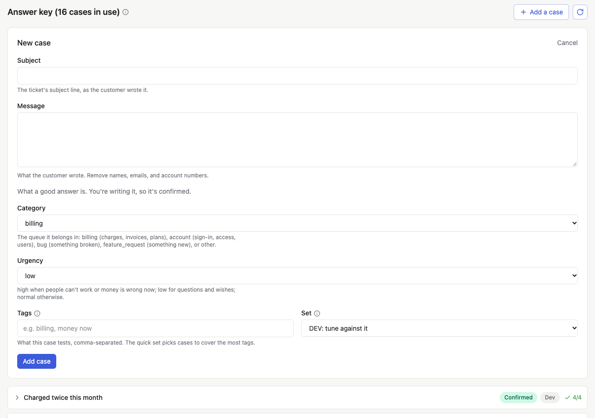
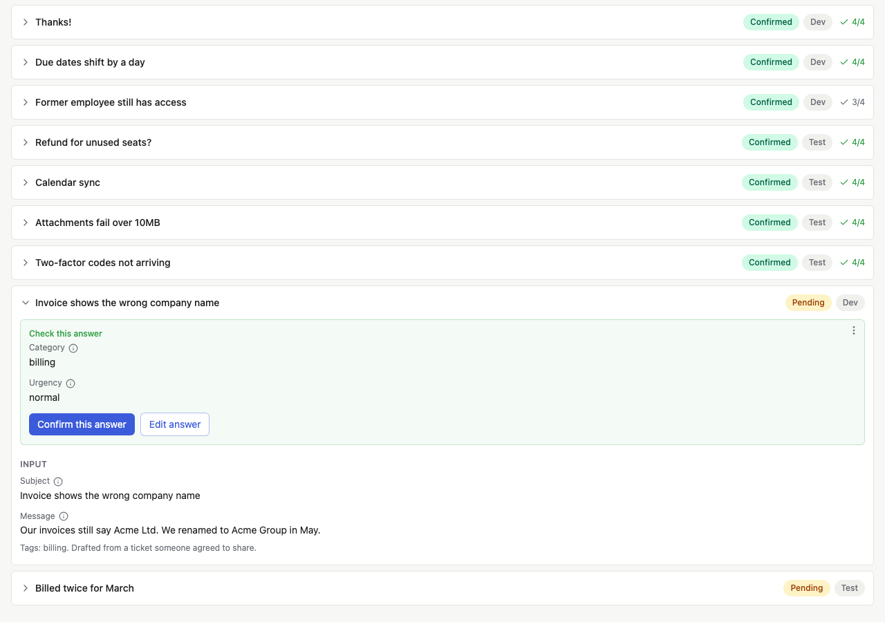

# Build your answer key

A feature's answer key is its set of cases: real inputs, each with the
answer a person on your team confirmed. It's what every model is graded
against, so a test is only as good as its answer key. This guide covers
adding cases, confirming their answers, and keeping a model's guesses
from becoming the truth.

Every feature's answer key is at the bottom of its page in your admin.

## How many cases

Start with 10 to 20 real inputs, with names and personal details
removed, and grow toward 50. Pick the inputs that matter: the common
ones, the ones that went wrong before, and the edge cases a person would
argue about. A score on a handful of cases can be off by a lot; every
score says how many cases it rests on and how far off it could be.

Keep a few cases aside as a held-out set (`TEST`) that you never tune
your prompt against, and tune against the rest (`DEV`).

## Add a case by hand

Press **Add a case** at the top of the answer key. Fill in the input as
your feature would see it, then the right answer, and save. A case you
add with its answer is confirmed: you're the person who said it's right.



Each field has a label and a short help text from the suite, so a
teammate confirming answers weeks later knows what each one means. Where
judging an answer takes more than that, the suite's `answerGuide` is a
press away: the info button beside **Answer key** opens it as **How to
judge an answer**.

## Start from the suite's cases

A suite can come with `starter` cases. When some aren't in the answer
key yet, it offers **Add N starter cases**. They arrive pending, to
confirm like any draft, unless the suite's author already reviewed them.
A starter you retired isn't offered again.

## Describe the cases you want

On a suite with `draftMore`, **Add a case** has a second tab, **Describe
them**. Say what you want in your own words ("three guardrail cases where
the person states a salary floor") and how many. A model writes them
from that and the cases you have. Each arrives pending, split between
`DEV` and `TEST` like any new case, and counts only once you confirm it.

**Answer key health** helps too: pick topics that have only one case and
press **Draft cases for the topics you picked**. On a suite without
`draftMore`, a topic opens **Add a case** with it already tagged.

## Confirm drafted answers

Cases also arrive as drafts, with an answer someone or something
proposed but nobody has checked:

- **A model drafted it**, from your app's real activity (the weekly
  check can draft a few a week; see [Keep the answer key
  useful](upkeep.md)).
- **A thumbs down** was turned into a case ([Thumbs from your
  users](thumbs.md)).
- **An import** brought in test data you already had ([Cases you
  already have](suites.md#cases-you-already-have)).
- **You asked for more** with **Draft N more cases**, above.

A draft's answer is **Pending**: it's never graded against. Open the
case: the proposed answer comes first, under **Check this answer**,
with **Confirm this answer** and **Edit answer** beside it, and the
input below, as labeled rows and readable text. Confirming one marks it
**Confirmed** at once and opens the next draft waiting, so you can work
through them in a row while the save finishes behind it.

### Point at what to check

A suite's `lookAt` names what a person should look at for each case,
with text to highlight in its input:

```ts
lookAt: (input) =>
  input.dueDate
    ? [{ note: "the deadline: each item should keep it", marks: [input.dueDate] }]
    : [],
```

The notes show under **Look at**, and each mark is highlighted wherever
it appears in the input. When models' latest tests disagree with the
answer, the list says so on its own: that's the surest sign a case needs
a closer look.

Pick the look-at notes by rule from the case (a dealbreaker beside what it rules
on), never from the drafted answer's own reasoning: that steers a person
toward agreeing with the draft, which defeats the point of checking it.

A suite's `outputLine` shows what each model wrote, beside its latest
test, below the answer: "Get a full-time admin job in local
government", or "Left as typed". It makes an answer easy to check
against something concrete:

```ts
outputLine: (o) => o.headline ?? "Left as typed",
```



When a model drafts many cases at once, have it flag the ones it's
unsure of and review those first, and check every term in its answer
against the input. In one app, 43 of 218 drafted terms were things the
input never said.

## Answers you can use before you've checked them

Sometimes the owner says "use them so we can test, I'll review later."
**Provisional** answers are used by tests, and every score that rests on
them says so. Import answers as provisional, or press **Test with
drafts, as provisional** above the answer key to put every pending one
to use. Open one to **Confirm this answer** as it is or **Edit answer**
first. Nothing is ever confirmed on someone's behalf.

## Rate blind

When a feature's cases are items your app already handled (the cases
are real tickets, and the answers are what someone did with them), what
someone did isn't proof it was right, and seeing what the app decided
sways the person rating. For these suites (`caseKind: "imported"`), the
answer key links to **Rate blind**: one case at a time, its input only,
never the app's answer. Give the right answer and a reason, or skip it.
Each rating is that person's own confirmed answer.

Leave it off with `rateBlind: false` on a suite whose answers are one
person's own, such as a verdict on their own data, which nobody else can
give, or when your app has no rate page.

## Answers that came with a suite

The ready-made crisis risk and hopelessness suites ship cases their
author already reviewed. They arrive confirmed and marked **Author
reviewed** (or **Expert reviewed**). Read them anyway: your app's users
may say things differently. Change any answer you disagree with; your
answer takes over, and the shipped review never replaces it.

## When you change an answer

Changing or confirming an answer makes earlier tests **Out of date** on
the board. Press **Rescore tests** to grade the answers those tests
already have against the new answer key. It's free: rescoring never
calls a model.
