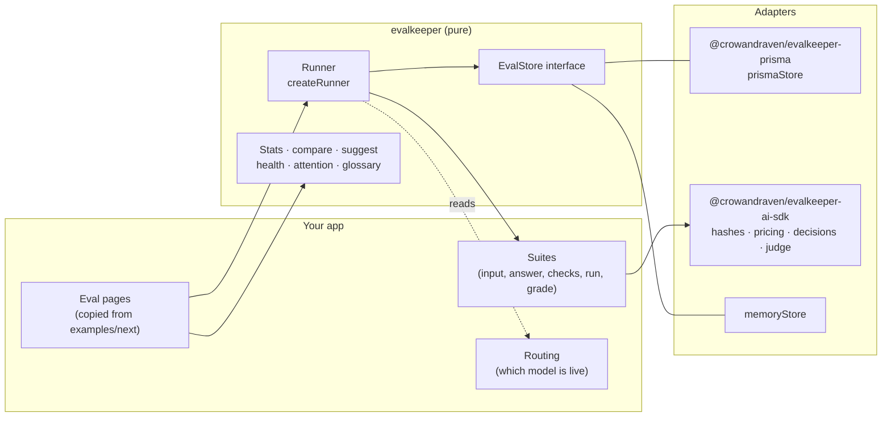

# Architecture

How the pieces fit, where each kind of change goes, and how they're
tested.

## Layers

- **The core** (`packages/core`) is pure TypeScript: suite and check
  types, statistics, the paired comparison, the suggestion rules, suite
  health, the glossary, grader helpers, and decision scoring (`decisions.ts`). The runner is the one
  server-only module (it hashes with `node:crypto`), and it talks to
  storage only through `EvalStore`.
- **Adapters** connect the core to services: `@crowandraven/evalkeeper-prisma` stores
  everything in your database, and `@crowandraven/evalkeeper-ai-sdk` hashes
  instructions, prices calls and decisions, and judges meaning with a model. Another
  ORM or AI library is another adapter.
- **Your app** owns its suites, its routing (which model is live), its
  auth, and its pages. The pages in `examples/next` are meant to be
  copied and restyled.

## A test, step by step

1. `createRun` records a test: the suite, the model, the reasoning
   setting, the instructions hash, and the grader version.
2. `runEval` loads the cases in use (not retired, with a confirmed or
   provisional answer), skips any already answered by an earlier leg,
   and for each case and repeat reuses an identical request from the last
   7 days or calls the suite's `run` with a timeout.
3. Each answer is graded by `grade`, then `gradeTogether` adds checks
   across answers, and the metrics are stored on the test.
4. `board` reads every model's latest test, compares each with the live
   model, and `suggest` and `suiteHealth` turn the board into words.

## Where changes go

| Change                                   | Where                                                            | Tested by                                                                    |
| ---------------------------------------- | ---------------------------------------------------------------- | ---------------------------------------------------------------------------- |
| A rule for suggestions, health, or stats | `packages/core/src`                                              | Unit test next to it                                                         |
| A new word on the pages                  | `packages/core/src/glossary.ts`                                  | `glossary.test.ts` (length, form)                                            |
| A storage method                         | `store.ts`, `memoryStore.ts`, every adapter                      | `describeStoreContract`                                                      |
| A database or ORM                        | A new adapter package implementing `EvalStore`                   | `describeStoreContract`                                                      |
| An AI library                            | A new adapter package                                            | Unit tests with a mock model                                                 |
| A suite                                  | Your app (`examples/next/lib/suites` for examples)               | Grader tests on fixed outputs                                                |
| Feedback (ratings, cases from them)      | `feedback.ts`, a `FeedbackStore` in every adapter                | `feedback.test.ts`, `describeFeedbackStoreContract`                          |
| The weekly check                         | `weekly.ts`, `runner.startDriftCheck` / `runDriftCheck`          | `weekly.test.ts`, runner tests, browser tests                                |
| Versioned settings and rollback          | `settings.ts`, a `SettingsStore` in every adapter                | `settings.test.ts`, `describeSettingsStoreContract`, browser tests           |
| The copy-in CLI                          | `packages/core/src/cli`, templates from `examples/next`          | `cli/addPages.test.ts`, `examples/next/test/cli.test.ts` (typechecks a copy) |
| A page or component                      | `examples/next/app/evals`, `examples/next/components/evalkeeper` | End-to-end tests                                                             |

## Versions

Packages follow semantic versioning; until 1.0 a minor version may change
an interface, and CHANGELOG.md says how to update. A change to what a
suite's grading means bumps that suite's `graderVersion`, so older tests
say they were graded differently.
