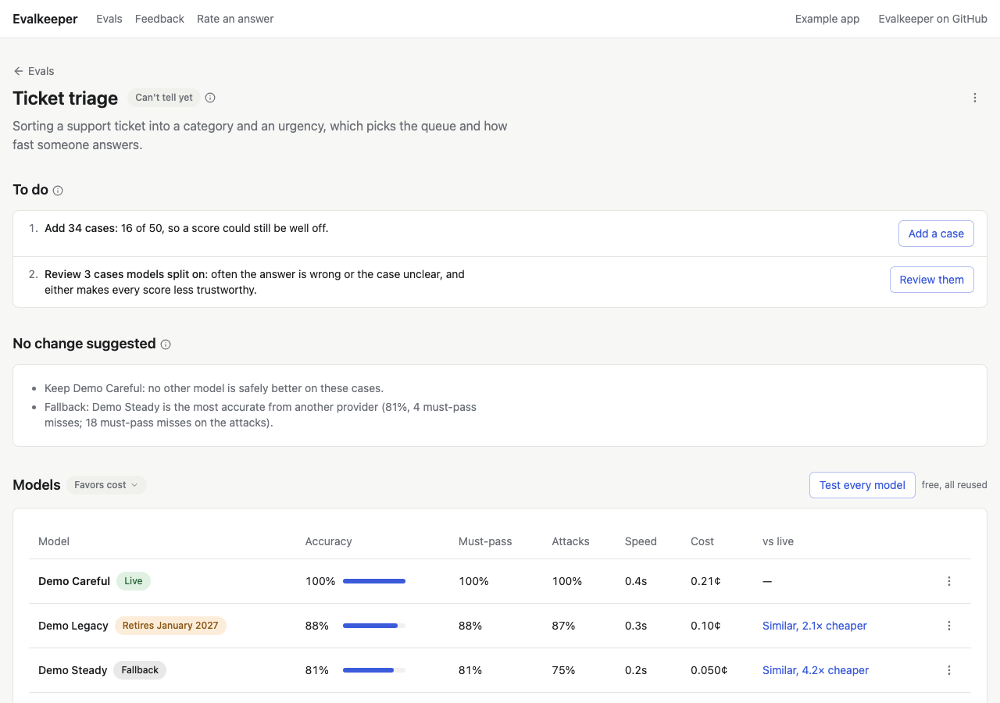
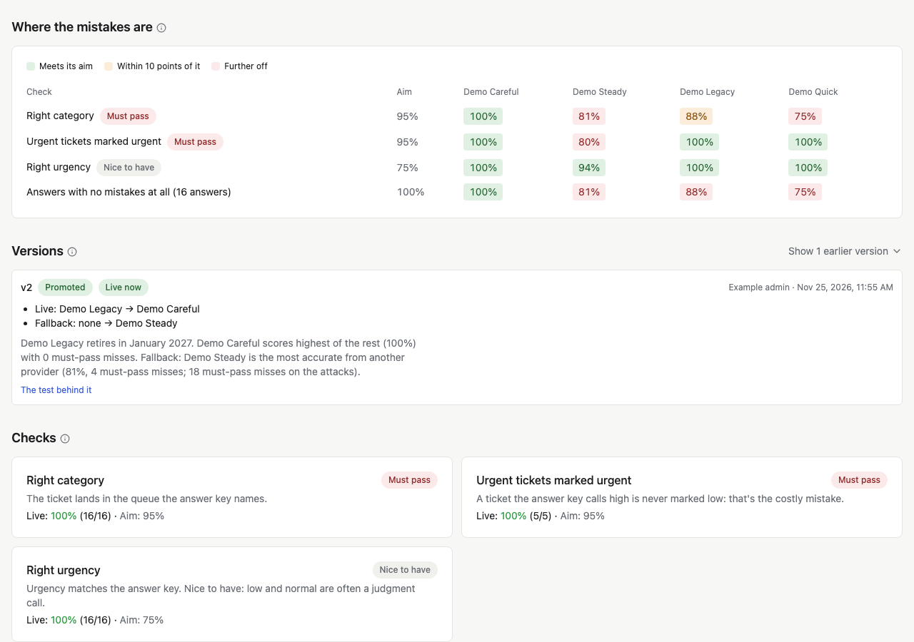
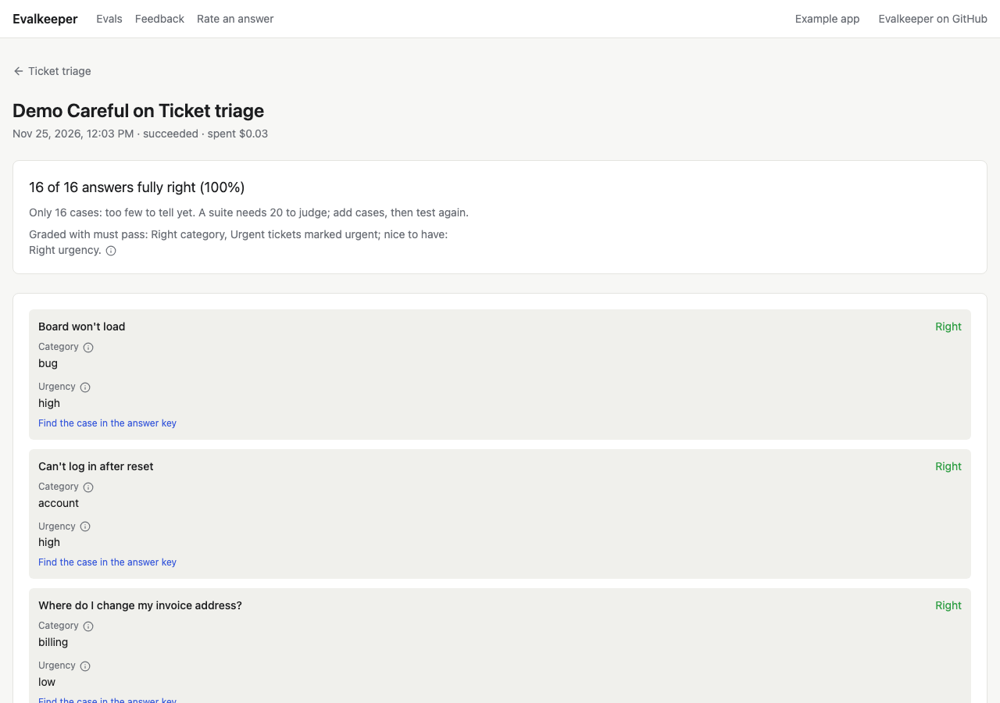
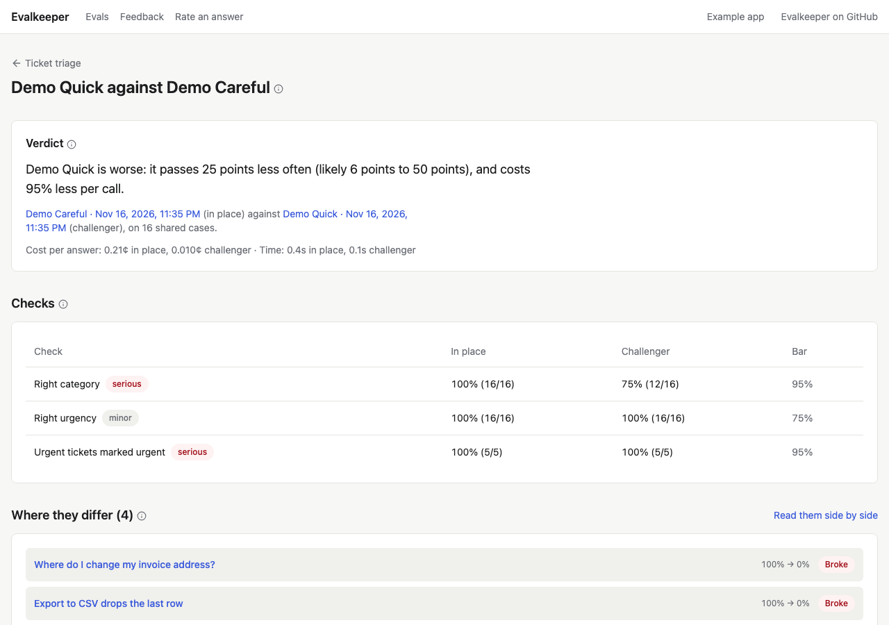
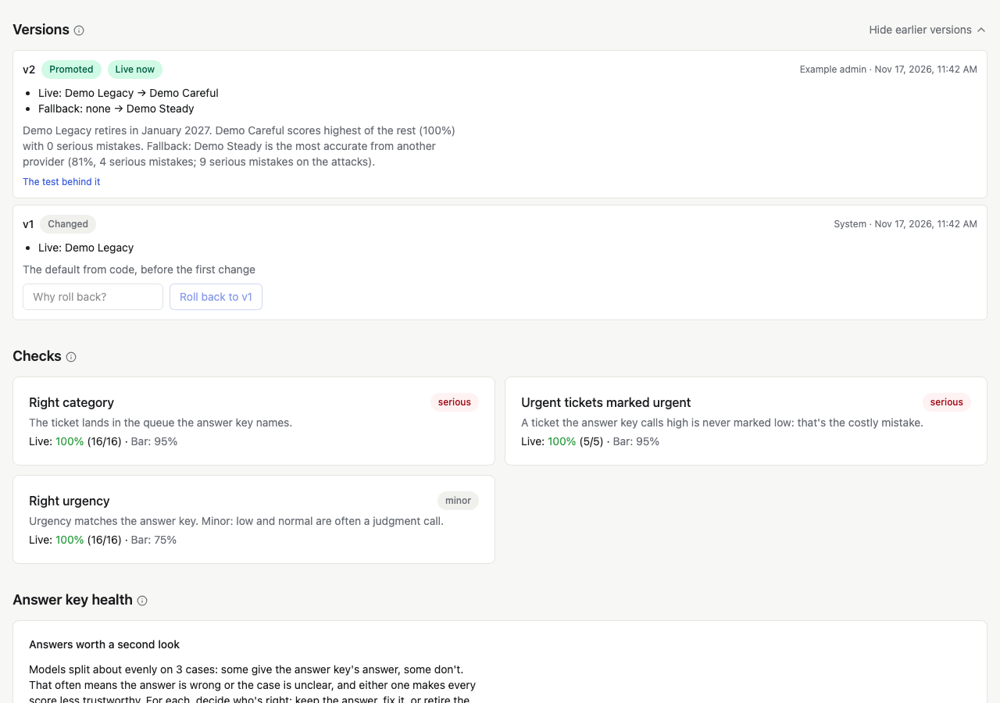

# Test models and choose one

Once a feature has an answer key, you can test any model your app can
use against it, see which does best, and make it live, with the
evidence on the record. This guide walks through it on a feature's page.

## Test the models

The **Models** table lists every model the feature can use. Press **Test
every model** to test them all, or open a row's menu (⋮) and choose
**Test** to test just that model. The menu shows what the test should
cost first (`~$0.16`), or "free" when every answer can be reused from a
test in the last week.

A test sends every case in use to the model, grades each answer with the
suite's checks, and records what each answer cost and how long it took.
The page refreshes while it runs. A long test keeps going in the
background; you can leave the page.

## Read the board

For each model:

- **Accuracy:** the share of the checks it passed, with partial credit.
  Hover it for how many.
- **Must-pass:** the share of answers with no must-pass miss, a mistake
  that would change what your product does (the wrong queue, a missed
  urgent ticket). Higher is better, and it matters more than accuracy.
  Hover it for how many misses; the suggestion compares those counts.
- **Attacks**, when the feature has attack cases: the share of attack
  answers with no must-pass miss.
- **Speed and cost:** seconds and cost per answer.
- **Confidence** and **Calibration**, for decision models: how well
  their probabilities fit their answers ([Concepts](concepts.md)).
- **vs live:** is its accuracy **Better**, **Similar**, or
  **Worse** than the live model's, or **Can't tell** (too few cases)?
  Evalkeeper works this out from the cases both tested, not from the gap
  between scores, so a 3-point gap on 16 cases isn't called a win. When
  it's similar, it says what it gains on the feature's priority:
  "Similar, 4× cheaper".

Beside **Models**, **Favors cost**, **Favors speed**, or **Favors
accuracy** says what the feature weighs once accuracy holds. It starts as
the suite's `priority` in code. Press the chip to see what it means and
pick another, with an optional reason: it's saved as a new settings version,
so it shows under **Versions** with who and why, and rolling back undoes
it. The suggestion, the row order, and the feature's to-do list all
follow it. The rows
come in the order the suggestion weighs them: the suggested model, then
live, then the rest by fewest must-pass misses, then accuracy, then the
priority. **Suggested** and **Suggested fallback** mark its picks.
There's no blended score: cost and speed only ever break ties between
models that are about as accurate.

A model marked **Out of date** was tested before the instructions, the
cases, or the checks changed. Test it again before trusting its numbers.

## Test a reasoning setting

Some models think before answering, and how much is a setting. Less is
faster and cheaper; more can be more accurate. The table's last row,
**Test a reasoning setting**, lists each model with the settings your
[catalog](models.md) gives it in `efforts`. Pick one and press **Test
this setting**.

The test gets its own row, such as "GPT-6.1 Sol · low reasoning", beside
the model at the feature's own setting. Its Test button tests it again at
that setting, and making it live sets the feature's reasoning to it.

## See where the mistakes are

**Where the mistakes are** shows how often each check passed, for every
model with a current test, beside each check's aim. Green meets the
aim, amber is within 10 points of it, and red is further below.
Must-pass checks come first.

Read it when two models score about the same: one may miss a must-pass
check the other passes. It's also where a check that every model fails
stands out, which usually means the check, not the models, needs a look.
A must-pass check every tested model misses also goes on the to-do list
as **Fix "check"**, with how far off it is and a link to the cases.

## See one test's answers

Open a model's score to see the test: every case, the model's answer,
whether each check passed, and why it failed. Read the failures before
changing a prompt. A low score is often the grader's fault: a check that
reads "16 weeks" but not "sixteen weeks", or an answer key that
disagrees with the instructions.

## Compare two models

Open a model's **vs live** verdict to compare its test with live's.
The compare page puts the verdict in plain words, each check's pass rate
side by side, and lists the cases the two graded differently. **Read them
side by side** opens both answers to each case next to the expected one.

## Make a model live

Above the board, **Suggested** names a live model and a fallback, with
one reason each. Accuracy is the floor: a cheaper or faster model is
suggested only when it's about as accurate, and only for a feature whose
priority is cost or speed. A model about to retire is never suggested,
and the fallback comes from another provider, so one outage can't take
out both. That needs models from at least two providers in your
[catalog](models.md): with one, no fallback can be suggested.

- When it differs from what's live, the to-do list at the top of the
  page has **Make X live** (or the fallback): press **Use the
  suggestion** there to take it.
- Or choose yourself: open a row's menu and pick **Make live** or **Make
  fallback**.

Either way, the change is saved as a new version under **Versions**: who
made it, when, why, and a link to the test behind it. Your app reads the
live model from there, so the switch takes effect without a deploy.

## Roll back

**Versions** shows the newest version and the live one; **Show N earlier
versions** opens the rest. Every earlier version has a **Roll back**
button. It asks why, so the
record says what went wrong, and saves the rollback as a version too.

## Test again when something changes

Test again after you change a prompt, when a provider ships a new
model, or when the weekly check flags drift. Rescore (free) after you
change an answer or a check. [Best practices](best-practices.md) has
more on reading results.
