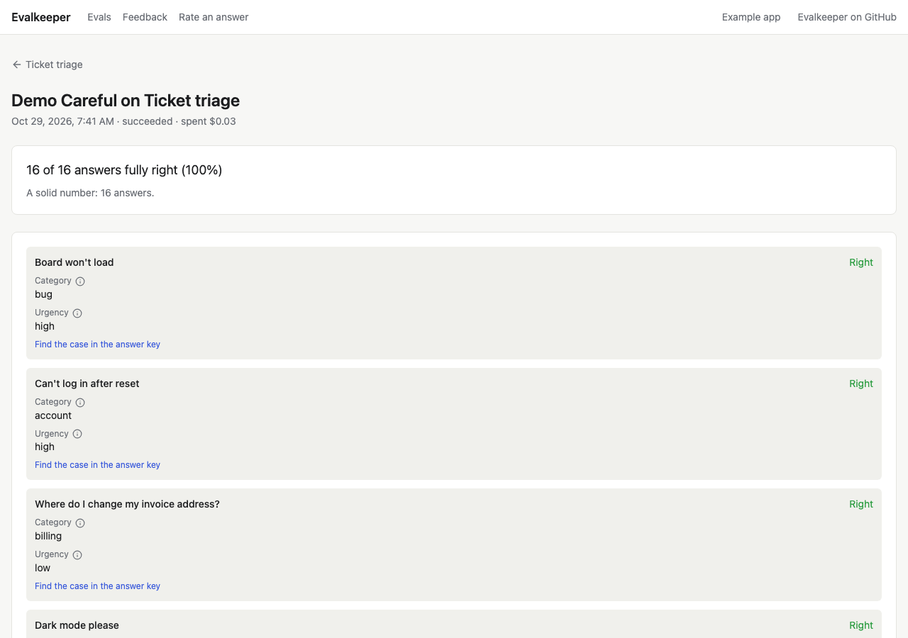
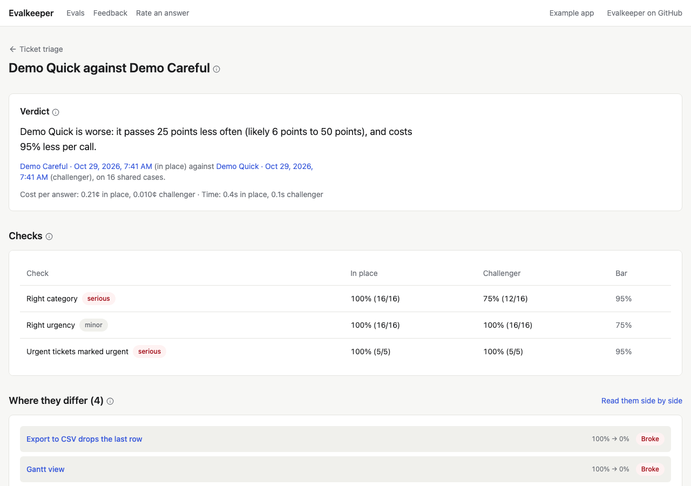

# Test models and choose one

Once a feature has an answer key, you can test any model your app can
use against it, see which does best, and make it live, with the
evidence on the record. This guide walks through it on a feature's page.

## Test the models

The **Models** table lists every model the feature can use. Press **Test
every model** to test them all, or the test button on one row to test
just that model. The button shows what the test should cost first
(`~$0.16`), or "Free" when every answer can be reused from a test in the
last week.

A test sends every case in use to the model, grades each answer with the
suite's checks, and records what each answer cost and how long it took.
The page refreshes while it runs. A long test keeps going in the
background; you can leave the page.

## Read the board

For each model:

- **Score:** the share of cases it got fully right, and how many.
- **Serious mistakes:** answers that would change what your product
  does (the wrong queue, a missed urgent ticket). Fewer is better, and
  it matters more than the score.
- **Time and cost** per answer.
- **Against live:** is it **More accurate**, **About as accurate**, or
  **Less accurate** than the live model, or are there **Too few cases to
  tell**? Evalkeeper works this out from the cases both tested, not from
  the gap between scores, so a 3-point gap on 16 cases isn't called a
  win.

A model marked **Out of date** was tested before the instructions, the
cases, or the checks changed. Test it again before trusting its numbers.

## See one test's answers

Open a model's score to see the test: every case, the model's answer,
whether each check passed, and why it failed. Read the failures before
changing a prompt. A low score is often the grader's fault: a check that
reads "16 weeks" but not "sixteen weeks", or an answer key that
disagrees with the instructions.

## Compare two models

Open a model's **Against live** verdict to compare its test with live's.
The compare page puts the verdict in plain words, each check's pass rate
side by side, and lists the cases the two graded differently. **Read them
side by side** opens both answers to each case next to the expected one.

## Make a model live

Above the board, **Suggested** names a live model and a fallback, with
one reason each. Accuracy is the floor: a cheaper or faster model is
suggested only when it's about as accurate, and only for a feature whose
priority is cost or speed. A model about to retire is never suggested,
and the fallback comes from another provider, so one outage can't take
out both.

- Press **Use these** to take the suggestion.
- Or choose yourself: open a row's menu and pick **Make live** or **Make
  fallback**.

Either way, the change is saved as a new version under **Versions**: who
made it, when, why, and a link to the test behind it. Your app reads the
live model from there, so the switch takes effect without a deploy.

## Roll back

Every earlier version has a **Roll back** button. It asks why, so the
record says what went wrong, and saves the rollback as a version too.

## Test again when something changes

Test again after you change a prompt, when a provider ships a new
model, or when the weekly check flags drift. Rescore (free) after you
change an answer or a check. [Best practices](best-practices.md) has
more on reading results.
