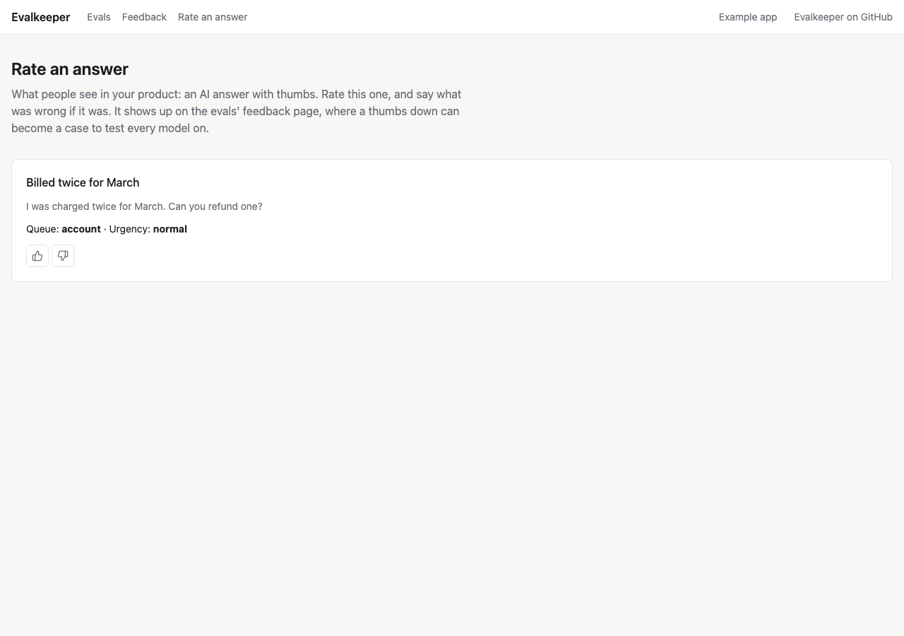

# Thumbs from your users

The people using your product notice bad answers first. Thumbs up and
down on your AI answers tell you which features they're unhappy with,
and a thumbs down on an input you were allowed to keep can become a test
case, so the same mistake is caught next time.

## What people see

Each AI answer in your product gets a thumbs up and a thumbs down
(`Thumbs` from `@crowandraven/evalkeeper/react`). A thumbs down asks
"What was wrong?", optionally, and thanks them. Pressing the same thumb
again takes the rating back. Each person has one rating per answer.

In a chat, put the thumbs under each of the assistant's replies, not on
the whole conversation.

## Where ratings go

**The hub** counts this week's thumbs down. **The weekly check** flags a
feature when its share of thumbs down climbs, so a feature people have
started to dislike shows up even when its test score hasn't moved.

**The Feedback page** lists each feature's thumbs up and down this week,
and every thumbs down **Waiting** for a look, with its reason, the input,
and the answer people saw.

## Turn a rating into a case

For each thumbs down waiting:

- **Make a case** freezes the input into the feature's answer key as a
  draft. Write the right answer and confirm it, as with any draft
  ([Build your answer key](answer-key.md)). A thumbs up can propose the
  model's answer as the right one, for you to confirm.
- **Dismiss** marks it looked at, when there's nothing to learn from it.

A rating becomes a case only if your app kept the input behind the
answer, which it should do only when the person agreed and with names
and contact details removed. Without the input, the rating still counts
toward the weekly flag, and the page says it can't become a case.

## Set it up

Add the `EvalFeedback` model from the schema and create
`prismaFeedbackStore(prisma)`. If your app already records thumbs in its
own table, map it instead ([Your own thumbs table](bring-your-own.md#your-own-thumbs-table)). Put a thumbs up and down on each AI answer
(`Thumbs` from `@crowandraven/evalkeeper/react`; the example's "Rate an
answer" page, `examples/next/app/try`, shows one), with a server action
that looks the answer up by its id, never trusting what the browser sends,
and calls `feedbackStore.rate(...)` with the person's id.

To let ratings become cases, keep the input behind each answer, in the
suite's input shape, with names and contact details removed, and only
when the person agreed. Pass it as `input`, and the answer as `output`.
Give suites whose outputs look like answers a `labelFromOutput`, so a
thumbs up can propose the model's answer. The feedback page
(`FeedbackView`) lists ratings and makes cases with `caseFromFeedback`.

**In a chat**, put the thumbs under each of the assistant's replies, not
on the conversation. Use the reply's message id as `targetId`, and pass
the reply's text as `output`, so a reviewer reads what was rated. For
`input`, keep what the suite needs to replay that turn (the latest
message, and the earlier ones it depends on), and only with the person's
agreement; without it, the rating still counts toward the thumbs-down
alerts but can't become a case. Ask for the reason only on a thumbs
down, and keep it short: "What was wrong?"
