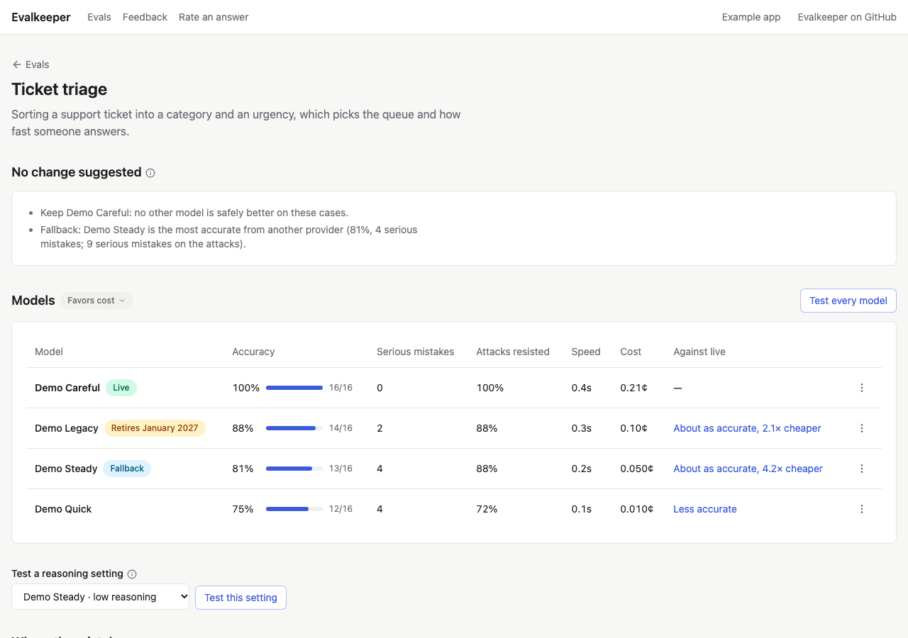

# Try the example

See every screen working before you change your own app. The example is
a small Next.js app with a few AI features (sorting support tickets,
pulling action items from meeting notes, routing tickets, and spotting
crisis risk in a chat message), already wired to Evalkeeper. It runs on
demo models, so it needs no API keys and costs nothing.

## Run it

You need Node 22 and git.

```bash
git clone https://github.com/seanhudson/evalkeeper.git
cd evalkeeper
npm install
npm run build
cd examples/next
cp .env.example .env
npm run setup
npm run dev
```

`npm run setup` makes a local SQLite database (`prisma/dev.db`) and fills
it with the example's cases. Then open `http://localhost:3000/evals` in your browser.

## A first look, in five minutes

1. **Open a feature.** On the hub, open **Ticket triage**. Its answer
   key, at the bottom, holds 16 support tickets, each with the category
   and urgency a person confirmed.
2. **Test every model.** Press **Test every model**. Each demo model
   answers every ticket, and the board fills in with each one's score,
   serious mistakes, time, and cost.

   

3. **Read the suggestion.** Above the board, Evalkeeper suggests a live
   model and a fallback, with its reasons. Press **Use these** to make
   them live. The change shows under **Versions**, with the test behind
   it and a button to roll it back.
4. **See where two models differ.** In the **Against live** column,
   open "Less accurate" for any model. The compare page says which is
   better, in plain words, and lists the cases they graded differently.
5. **Rate an answer.** Open **Rate an answer** in the header, and press
   thumbs down on the sample answer. Then open **Feedback**: your rating
   is waiting there, ready to become a case.

## Add real models

To test real models next to the demo ones, add a key to `.env` and
restart:

```bash
OPENAI_API_KEY=sk-...
ANTHROPIC_API_KEY=sk-ant-...
# Jev, TypeSafe's System One model, for the ticket routing feature:
TYPESAFE_AI_API_KEY=...
```

Each provider's models then appear on every board. Tests of real models
cost real money; the board shows each test's estimated cost before you
press it. With a key set, action items are also matched by meaning, with
a judge model, instead of by shared words.
