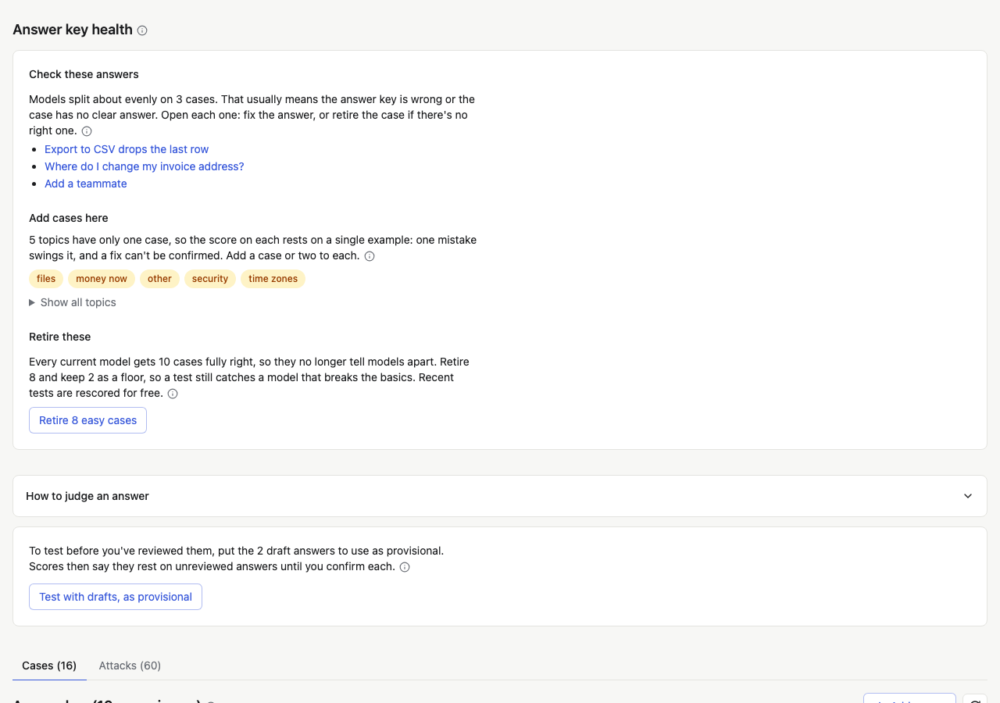

# Keep the answer key useful

An answer key isn't written once. Models get better, your feature
changes, and new kinds of input show up. A little upkeep each week keeps
the tests telling you something: new cases for what's new, and fewer
cases that every model already gets right.

## The weekly check

Once a week, Evalkeeper tests each feature's live model again on its
quick set, and the hub's **Weekly check** reports:

- **Drift:** a live model scoring lower than it did, often a provider
  changing a model under the same name.
- **Retiring:** live models the provider is about to retire.
- **Thumbs down:** features whose share of thumbs down climbed.
- **Drafted:** new draft cases from real use, waiting for a person.
- **Didn't finish:** checks that stopped partway.

**Run it now** runs it at once; while it runs, the button shows a
spinner and each feature's line reflects its newest check, so one that
failed earlier and passed when run again no longer shows. Scheduling it is step 8 of the
[setup](adding-to-your-app.md#8-schedule-the-weekly-check).

When it flags a feature, open it, test every model, and read what
changed before you switch anything.

## Review new drafts

If your suites draft cases from real use, a few arrive each week as
drafts. Confirm or fix their answers ([Build your answer
key](answer-key.md)); a draft nobody confirms is never graded against.

## Retire cases nobody misses any more

A case every model gets right, test after test, no longer tells models
apart. It still costs money each time it runs, and it makes every score
look closer than it is. Each case in the answer key shows how many of
the models tested on it got it right (`4/4`).

### Answer key health

Once three or more models have current tests, each feature's page shows
**Answer key health** above the answer key, when something needs a
look:

It lists what to do, in order:

1. **Answers worth a second look.** Cases models split about evenly on: some give
   the answer key's answer and some don't, and each case lists which. That
   usually means the answer is wrong or the case has no clear answer.
   Decide who's right, then press one of:
   - **The answer is right:** it's confirmed again, and leaves the list
     until a newer test splits on it.
   - **Fix the answer:** opens the case to edit it.
   - **Retire it:** for a case with no right answer.

   Once it's right, a split case is the most useful kind you have. Pairs
   of near-duplicates are here too: keep the clearer one.

2. **Add cases here.** Topics (tags) with only one case, so the score on
   each rests on a single example. On a suite with `draftMore`, pick
   topics and press **Draft cases for the topics you picked** (two each;
   pick none for all). Otherwise, a topic opens **Add a case** with it
   already tagged, and **Add a case** beside them opens it untagged. **Show all topics** lists every tag and its count.
3. **Retire these.** Cases every current model gets fully right: **Retire
   N easy cases** retires them all but a floor, then rescores recent
   tests for free. And drafts nobody reviewed in 30 days, which the
   weekly check retires on its own, or **Retire N old drafts now**.

### The floor

Retiring every easy case would leave nothing to catch a model that
breaks the basics. So some easy cases stay: as many as a tenth of the
cases in use, and at least one. The quick set's cases are kept first,
since the weekly check runs those. A case counts as easy only once three or more current models all
get it right; one model getting it right isn't evidence.

### Retire one case by hand

Retire a case for another reason too: its input no longer happens in
your product, or it nearly repeats another case. Open the case, open its
menu, and press **Retire case**. It leaves every future test and every
score, and its answers and past results stay in your database. Press
**Rescore tests** afterwards (free) so recent tests leave it out too.

## Test again when something changes

| What changed                                      | What to do                         | Costs            |
| ------------------------------------------------- | ---------------------------------- | ---------------- |
| A prompt, an output schema, or a tool description | Test again                         | A test per model |
| A provider shipped a new model                    | Add it to your catalog and test it | One test         |
| An answer or a check                              | Rescore tests                      | Free             |
| The weekly check flagged drift                    | Test every model, then decide      | A test per model |
