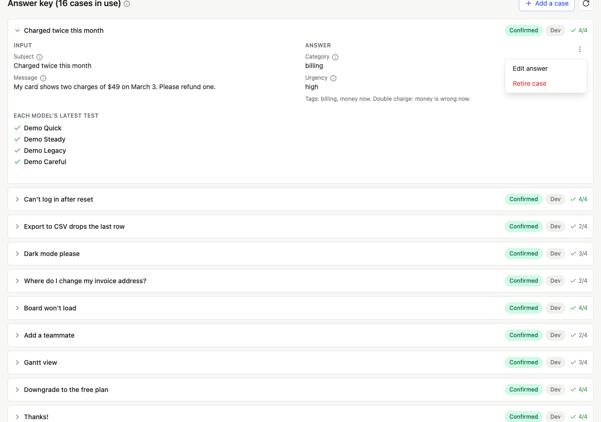

# Keep the answer key useful

An answer key isn't written once. Models get better, your feature
changes, and new kinds of input show up. A little upkeep each week keeps
the tests telling you something: new cases for what's new, and fewer
cases that every model already gets right.

## The weekly check

Once a week, Evalkeeper tests each feature's live model again on its
quick set, and the hub's **Weekly check** reports:

- **Drift:** a live model scoring lower than it did, often a provider
  changing a model under the same name.
- **Retiring:** live models the provider is about to retire.
- **Thumbs down:** features whose share of thumbs down climbed.
- **Drafted:** new draft cases from real use, waiting for a person.
- **Didn't finish:** checks that stopped partway.

**Run it now** runs it at once. Scheduling it is step 8 of the
[setup](adding-to-your-app.md#8-schedule-the-weekly-check).

When it flags a feature, open it, test every model, and read what
changed before you switch anything.

## Review new drafts

If your suites draft cases from real use, a few arrive each week as
drafts. Confirm or fix their answers ([Build your answer
key](answer-key.md)); a draft nobody confirms is never graded against.

## Retire cases nobody misses any more

Each case in the answer key shows how many of the models tested on it
got it right (`4/4`). A case every model gets right, test after test, no
longer tells models apart. It still costs money each time it runs, and it
makes every score look closer than it is.

To retire one, open the case, open its menu, and press **Retire case**.
It leaves every future test and every score. Its answers and past
results stay in your database.

Before you retire easy cases:

- **Keep a floor.** Keep about one in ten easy cases, the basics your
  feature must never get wrong, so a test still catches a model that
  breaks them.
- **Wait for enough models.** A case three or more current models all
  get right is easy; one model getting it right isn't evidence.
- **Check the cases models split on, and keep them.** When models divide
  about evenly on a case, its answer may be unclear, so check it first.
  Once it's right, it's the most useful kind of case you have.

Retire a case for another reason too: its input no longer happens in
your product, or it nearly repeats another case.

## Test again when something changes

| What changed                                      | What to do                         | Costs            |
| ------------------------------------------------- | ---------------------------------- | ---------------- |
| A prompt, an output schema, or a tool description | Test again                         | A test per model |
| A provider shipped a new model                    | Add it to your catalog and test it | One test         |
| An answer or a check                              | Rescore tests                      | Free             |
| The weekly check flagged drift                    | Test every model, then decide      | A test per model |
